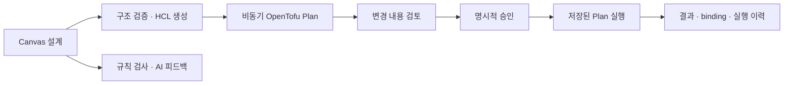

# Eolgae

**인프라 설계 의도를 검토 가능한 실행 계획으로 연결하는 작업 공간.**

Eolgae(얼개)는 AWS 인프라를 Canvas에서 구성하고, OpenTofu 실행 계획을 검토한 뒤 명시적으로 승인한 변경을 적용하는 InfraOps 애플리케이션입니다. 설계, 코드 생성, 실행 결과를 하나의 흐름에서 추적하는 것을 목표로 합니다.

## 해결하려는 문제

인프라 다이어그램, IaC 코드, 실제 클라우드 상태가 따로 관리되면 변경의 의도와 영향을 다시 맞춰 봐야 합니다. 다이어그램만으로는 배포할 수 없고, 실행 명령만으로는 어떤 설계를 검토하고 승인했는지 설명하기 어렵습니다.

Eolgae는 사용자가 그린 리소스와 관계를 코드로 변환하고, 검토한 Plan을 실행 단위로 보존합니다. AI 피드백은 설계 검토를 보조하며, 주요 구조 검증과 실제 변경 승인은 별도의 명시적 단계로 둡니다.

| 접근 | 얻고자 하는 효과 | 현재 제공 범위 |
| --- | --- | --- |
| Canvas에서 HCL 생성 | 다이어그램과 IaC를 따로 작성하는 중복 감소 | AWS 리소스 배치·관계 해석, HCL 미리보기, 구조 검증 |
| 저장된 Plan의 승인·실행 | 검토한 변경과 실행할 변경의 연결 | binary Plan 보존, checksum 검증, 단일 사용 Apply/Destroy |
| 비동기 실행과 이력 | 장시간 작업의 진행·실패 지점 파악 | worker queue, 단계별 timeline, Canvas별 실행 이력 |
| 규칙 검사와 AI 피드백 | 구조적 오류와 설계상 고려사항 검토 | 주요 보안·가용성 baseline, 사용자 검토 기준 반영 |
| 실제 상태와 설계 연결 | 배포 이후 변경과 관리 책임 추적 | Apply 결과의 binding 기반 구현; live inventory·drift는 후속 범위 |

위 효과는 설계 목표입니다. 작업 시간 절감률이나 운영 비용 개선률을 측정한 결과로 제시하지 않습니다.

## 핵심 흐름



- Apply-ready Plan에는 실행 artifact와 state backend 정보가 필요합니다. Read-only preview Plan은 승인·Apply할 수 없습니다.
- 승인을 받은 Plan은 한 번만 실행 대상으로 사용할 수 있습니다. 실패 후에는 새 Plan을 생성해 다시 검토합니다.
- Destroy도 별도의 Destroy Plan 생성과 승인을 거칩니다.
- `applied`는 마지막 Apply 완료 상태입니다. 리소스가 현재 정상 운영 중이라는 의미는 아닙니다.

## 구현 범위

**AWS Design + Deploy**

- React Flow 기반 Canvas, 리소스 속성 편집, 템플릿·구성 묶음 삽입
- VPC/Subnet 배치, Security Group 연결, CIDR·가용성 제약 검사
- Cross-account IAM Role 연결과 STS 검증
- OpenTofu HCL 생성, 비동기 Plan, 승인 기반 Apply/Destroy
- 실행 artifact 저장, 진행 이벤트, audit 기록, Canvas별 실행 이력

**Kubernetes 기반 기능**

- Kubernetes Canvas, YAML 생성과 로컬 manifest 검증
- Target 등록, read-only RBAC manifest, 환경변수 기반 secret reference 해석
- Canvas 데이터 기반 리소스 트리 미리보기

실제 Kubernetes API 연결, live inventory, cluster-side dry-run, 명령 콘솔과 Pod exec는 아직 구현하지 않았습니다. AWS discovery/import와 drift detection도 후속 작업입니다. [구현 상태와 한계](docs/STATUS.md)를 확인할 수 있습니다.

## 구조

| 계층 | 구성 | 역할 |
| --- | --- | --- |
| Web | Next.js, React, TypeScript, React Flow | 설계 편집, 검토, 실행 상태 표시 |
| API | Python, FastAPI, SQLAlchemy | 인증, 소유권 확인, Canvas·Target·실행 API |
| Worker | Dramatiq, Valkey | Plan/Apply/Destroy 비동기 처리 |
| 실행 | OpenTofu, AWS STS | 임시 자격증명으로 승인된 인프라 변경 실행 |
| 저장 | PostgreSQL, artifact store | 설계 snapshot, 실행·승인·audit 정보, 실행 파일 |

```text
apps/web/          화면, Canvas 컴포넌트, API client
apps/api/eolgae/   API, 모델, 서비스, 생성·실행 pipeline
apps/api/tests/    graph, validation, 실행·승인 경계 테스트
infrastructure/   Cross-account Role용 CloudFormation 템플릿
packages/shared/  공유 타입 기반
docs/             설계 선택, 실행 방법, 현재 범위
```

상세 내용: [아키텍처](docs/ARCHITECTURE.md) · [설계 선택과 트레이드오프](docs/DESIGN-DECISIONS.md)

## 로컬 실행

Docker Compose, Python 3.13+, Node.js 24와 pnpm 9.12.0을 사용합니다. AWS 계정이나 LLM 키 없이도 Canvas 편집과 코드 생성 흐름을 살펴볼 수 있습니다.

```bash
cp .env.example .env
cp apps/web/.env.local.example apps/web/.env.local
```

`.env`의 `POSTGRES_PASSWORD`와 `JWT_SECRET`에 각각 별도로 생성한 값을 입력합니다.

```bash
openssl rand -hex 32
```

```bash
# 데이터 저장소, API, worker
docker compose up --build postgres valkey api worker
```

다른 터미널에서 웹 개발 서버를 시작합니다.

```bash
pnpm install --frozen-lockfile
pnpm --dir apps/web dev
```

웹은 `http://localhost:3000`, API 문서는 `http://localhost:8000/docs`에서 확인합니다. 회원가입 후 Canvas를 생성할 수 있습니다. AI 피드백은 LLM 설정이 필요하고, AWS 연결·Plan·Apply는 별도의 계정 및 권한 설정이 필요합니다.

[개발·검증 가이드](docs/DEVELOPMENT.md) · [AWS 연결 가이드](docs/AWS-CONNECTION.md) · [자격증명과 실행 경계](SECURITY.md)

## 검증

```bash
python3 -m venv .venv
. .venv/bin/activate
python -m pip install -e 'apps/api[dev]'
PYTHONPATH=apps/api:. python -m pytest apps/api/tests
pnpm --dir apps/web exec tsc --noEmit --incremental false
pnpm --dir apps/web build
```

단위 테스트는 외부 실행을 모의 처리합니다. 이 결과를 실제 AWS 전체 리소스 또는 Kubernetes 클러스터 검증으로 해석하지 않습니다. 초기 AWS 실계정 검증 기록의 범위는 S3 생성·삭제입니다.

## 다음 단계

- Kubernetes client adapter와 읽기 전용 inventory·리소스 상세 조회
- AWS 리소스 발견 모델과 ownership 구분
- 실제 상태의 freshness 및 drift 표시
- Canvas page/router의 책임 분리와 UI 사용성 개선

AWS 변경은 계속 Plan·승인 경계를 유지합니다. 구현되지 않은 운영 기능은 현재 지원 기능과 구분해 확장합니다.

외부 아이콘 출처는 [THIRD-PARTY-NOTICES.md](THIRD-PARTY-NOTICES.md)에 정리했습니다.
