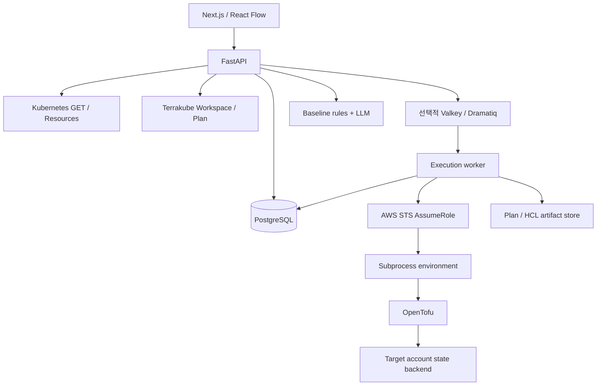

# Architecture

## 경계와 데이터 흐름

API는 요청자·리소스 소유권과 실행 가능 상태를 확인하고 작업을 큐에 넣습니다. Worker는 Canvas snapshot을 사용해 OpenTofu를 실행하고 상태·진행 이벤트를 DB에 기록합니다. 웹은 deployment polling으로 결과를 표시합니다. 현재 stdout 실시간 스트리밍이나 SSE 기반 실행 추적은 제공하지 않습니다.

## 설계 데이터와 생성

`canvases.graph` JSONB에 편집 가능한 graph를 저장합니다. 코드에서는 다음 개념을 구분하는 방향으로 해석합니다.

| 개념 | 예 |
| --- | --- |
| Resource | EC2, S3, VPC 등의 리소스 |
| Placement | EC2가 속한 Subnet, Subnet이 속한 VPC |
| Association | Security Group 연결, Route Table 연결 |
| Intent | CIDR, AZ, 공개 여부와 같은 사용자 선택 |
| Constraint | CIDR 범위, ALB의 최소 Subnet 수 등 검증 규칙 |

이는 해석 경계이며 다섯 종류의 정규화 테이블이 모두 구현됐다는 의미는 아닙니다. 배치·참조 해석은 `graph_model.py`, 검증은 `validation.py`, AWS HCL 출력은 `tofu_adapters/aws_resources.py`가 맡습니다. Kubernetes YAML 생성은 별도 pipeline입니다.

주요 진입점:

- [Graph interpretation](../apps/api/eolgae/pipelines/graph_model.py)
- [Validation](../apps/api/eolgae/pipelines/validation.py)
- [HCL generation](../apps/api/eolgae/pipelines/tofu_generator.py)
- [AWS adapter](../apps/api/eolgae/pipelines/tofu_adapters/aws_resources.py)
- [Kubernetes generation](../apps/api/eolgae/pipelines/kubernetes_generator.py)

## Plan과 승인된 실행

1. API가 Plan 시작 시 immutable Canvas version과 deployment를 만듭니다.
2. Worker가 검증된 AWS 연결로 STS AssumeRole을 수행합니다.
3. 자격증명은 실행 프로세스의 환경으로 전달합니다.
4. HCL을 생성하고 `tofu init`과 `tofu plan`을 실행합니다.
5. Apply 가능한 경우 binary Plan과 backend 정보를 보존합니다.
6. 사용자가 Plan을 승인하면 별도의 Apply deployment를 생성합니다.
7. Worker는 artifact checksum을 확인하고 저장된 Plan을 실행합니다.

승인 뒤 변경된 Canvas를 다시 생성해 실행하지 않습니다. 한 Plan에서 실행 deployment가 만들어지면 성공 여부와 관계없이 다시 사용할 수 없습니다. Destroy도 같은 검토·승인 원칙을 사용합니다.

State backend는 대상 계정의 S3와 DynamoDB lock table을 사용합니다. Backend bootstrap 권한이 없으면 read-only preview로 fallback할 수 있으며, 해당 Plan에는 승인 가능한 artifact/backend가 없습니다. Apply 권한을 활성화한 연결에서는 Plan 준비 단계에서도 backend 생성이 일어날 수 있습니다.

## 저장과 추적

- `canvas_versions`: Plan에 사용한 설계 snapshot
- `deployments`: 실행 상태, 승인, 원본 Plan 참조, 진행 이벤트, artifact metadata
- `audit_logs`: 변경·실행의 추적 정보
- Artifact store: HCL과 binary Plan 파일; local/S3 backend 지원
- AWS binding: Apply 이후 state에서 추출한 리소스 식별 정보의 Canvas 연결

Binding은 마지막 실행 결과에 대한 연결입니다. 주기적인 live inventory 수집이나 drift 판정을 대신하지 않습니다. Artifact에는 민감한 설정이 포함될 수 있으므로 소스 저장소와 분리하고 접근을 제한해야 합니다.

## AI 검토

LLM은 사용자 검토 기준과 설계 graph를 바탕으로 피드백을 생성합니다. Critical/High 수준의 일부 구조적 위험은 deterministic baseline rules로 보완합니다. AI 피드백은 코드 실행 권한을 가지지 않으며, 피드백 확인 자체가 Apply 승인을 만들지 않습니다.

## Kubernetes 확장 경계

Target에는 endpoint와 profile 참조를 저장합니다. 관리자 profile은 사용자·서버·namespace·token/CA 파일을 연결합니다. GET 전용 adapter가 제한된 6종 리소스를 조회하며 Resources 화면은 상태·관계·시각과 부분 실패를 표시합니다. raw 객체와 Secret은 저장하지 않습니다. 자동 수집·drift·cluster dry-run은 후속입니다.

## 실행 책임 분리

기본 API 이미지에는 OpenTofu가 없습니다. standalone worker만 직접 실행하며 Terrakube binding은 API와 worker에서 직접 실행을 차단합니다. 원격 Plan 요청은 commit SHA·Canvas 참조 버전·요청 ID·Run ID를 기록합니다. timeout은 unknown으로 남고 기존 Run을 확인합니다. 원격 State·승인·Apply/Destroy는 Terrakube가 소유합니다.
